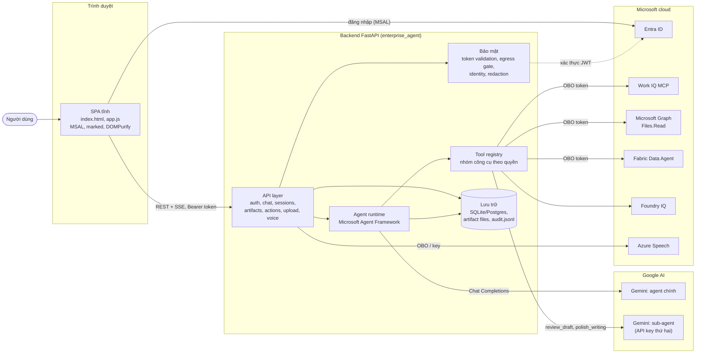
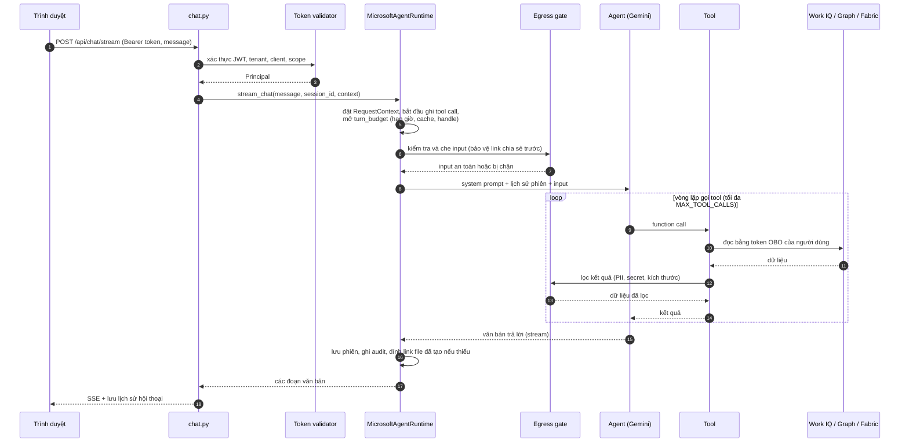
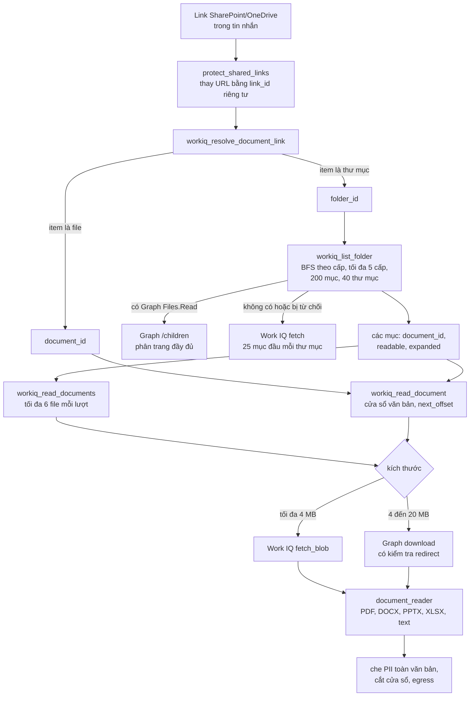
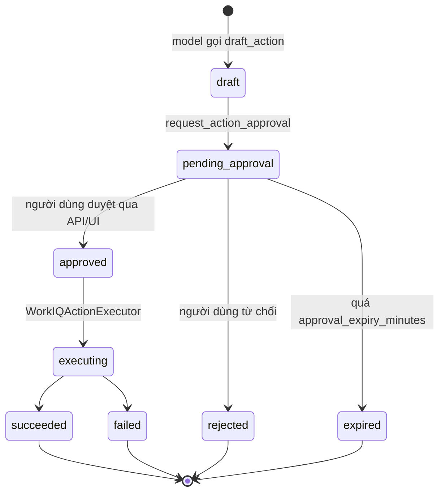
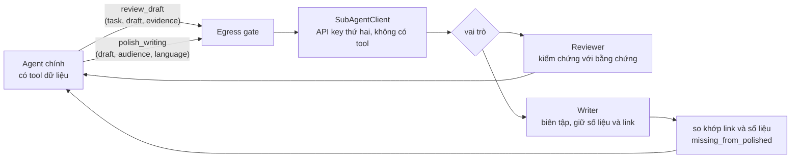

# Kiến trúc Enterprise Agent

Tài liệu này mô tả kiến trúc của `enterprise-agent`: ứng dụng chat dùng Gemini (qua Microsoft Agent Framework) để đọc Microsoft 365, phân tích tài liệu và tạo file Word/Excel/PowerPoint/PDF/Markdown/JSON. Sơ đồ dùng Mermaid, hiển thị trực tiếp trên GitHub và VS Code (có extension Mermaid).

## 1. Bức tranh tổng thể



Nguyên tắc xuyên suốt:

- **Quyền của người dùng, không phải quyền của ứng dụng**: dữ liệu Microsoft 365 được đọc bằng token On-Behalf-Of của người đăng nhập.
- **Đọc là mặc định, ghi cần con người duyệt**: model không có tool nào để duyệt hay thực thi hành động.
- **Mọi dữ liệu đi ra model ngoài đều qua egress gate** (che PII, chặn secret, giới hạn kích thước).

## 2. Các lớp trong mã nguồn

```mermaid
flowchart TB
    subgraph L1["Giao diện"]
        UI["ui/<br/>app.js, microsoft-auth.js, chat-markdown.js"]
    end

    subgraph L2["API (api/)"]
        A1["app.py<br/>lắp ráp ứng dụng, middleware,<br/>/health, /api/config, /api/metrics"]
        A2["auth.py, chat.py, sessions.py,<br/>artifacts.py, actions.py,<br/>local_documents.py, voice.py"]
        A3["limits.py<br/>giới hạn body, đồng thời, tần suất"]
    end

    subgraph L3["Agent (agent/)"]
        R1["runtime.py<br/>MicrosoftAgentRuntime"]
        R2["factory.py, gemini.py<br/>client OpenAI-compatible cho Gemini"]
        R3["instructions.py, workflows.py<br/>system prompt theo nhóm công cụ"]
        R4["session.py<br/>phiên bộ nhớ hoặc bền vững"]
        R5["budget.py<br/>hạn giờ, cache, handle theo lượt"]
        R6["demo.py<br/>DemoRuntime không dùng LLM"]
    end

    subgraph L4["Công cụ (tools/, subagents/, artifacts/, actions/)"]
        T1["registry.py<br/>ToolRegistry"]
        T2["workiq/<br/>client, tools, link_resolver,<br/>folder, download, policy, search"]
        T3["fabric/, knowledge/, local/, mock.py"]
        T4["subagents/<br/>client, roles, tools"]
        T5["artifacts/<br/>service, renderers, templates, store"]
        T6["actions/<br/>service, policy, executor, store"]
    end

    subgraph L5["Nền tảng"]
        S1["security/<br/>token_validation, identity,<br/>egress, redaction"]
        S2["storage/<br/>database, conversations"]
        S3["telemetry/<br/>operations, tracing"]
        S4["config.py + config/*.yaml<br/>Settings"]
    end

    L1 --> L2 --> L3 --> L4
    L3 --> L5
    L4 --> L5
    L2 --> L5
```



| Lớp | Thư mục | Trách nhiệm chính |
| --- | --- | --- |
| Giao diện | `src/enterprise_agent/ui/` | SPA tĩnh: đăng nhập MSAL, chat streaming, lịch sử, upload, tải artifact, duyệt hành động. |
| API | `api/` | Xác thực Bearer token, rate limit, chat (JSON và SSE), phiên, artifact, hành động chờ duyệt, upload, giọng nói. |
| Agent | `agent/` | Dựng agent, chạy một lượt chat có hạn giờ, thử lại, circuit breaker, quản lý phiên. |
| Công cụ | `tools/`, `subagents/`, `artifacts/`, `actions/` | Đọc nguồn dữ liệu, tạo file, sub-agent, quy trình hành động có duyệt. |
| Nền tảng | `security/`, `storage/`, `telemetry/`, `config.py` | Danh tính, egress, lưu trữ, audit, cấu hình. |

## 3. Một lượt chat đi qua hệ thống như thế nào



Các cơ chế bảo vệ của một lượt (`agent/runtime.py`, `agent/budget.py`):

- **Hạn giờ**: `AGENT_TURN_TIMEOUT_SECONDS`, có phần dự trữ để tổng hợp câu trả lời (`AGENT_SYNTHESIS_RESERVE_SECONDS`).
- **Thử lại có chọn lọc**: chỉ khi chưa phát chữ nào và chưa gọi tool nào, để không lặp tác dụng phụ.
- **Circuit breaker** quanh nhà cung cấp model.
- **Phản hồi rỗng bị từ chối** thay vì trả về im lặng.
- **Cache và handle theo lượt**: kết quả đọc nguồn, `document_id`, `folder_id` chỉ sống trong một lượt, gắn với danh tính và token của người hỏi.

## 4. Nhóm công cụ và quyền

`ENABLED_TOOL_GROUPS` quyết định agent thấy công cụ nào; registry từ chối nhóm lạ. System prompt cũng được ghép theo nhóm đang bật.

| Nhóm | Công cụ | Ghi chú |
| --- | --- | --- |
| `mock_read` | `get_current_user`, `get_project_status`, `search_mock_documents`, `get_mock_calendar` | Dữ liệu giả để thử luồng. |
| `local_read` | `list_local_documents`, `read_local_document` | Chỉ ở môi trường development hoặc khi bật upload ở chế độ shared. |
| `workiq_read` | `workiq_resolve_document_link`, `workiq_list_folder`, `workiq_read_documents`, `workiq_read_document`, `workiq_search_documents`, `workiq_fetch`, `workiq_get_schema`, `workiq_search_paths` | Chỉ đọc, đi qua `policy.py` allowlist đường dẫn. |
| `fabric_read` | `fabric_query` | Dữ liệu có cấu trúc (doanh thu, chi phí, KPI). |
| `foundry_read` | `knowledge_query` | Foundry IQ knowledge base. |
| `artifact_generation` | `create_artifact` | Chỉ ghi file cục bộ, không đụng dữ liệu nguồn. |
| `workiq_write` | `draft_action`, `request_action_approval`, `get_action_status` | Chỉ soạn nháp và xin duyệt. |
| `subagents` | `review_draft`, `polish_writing` | Tự bật khi có `SUBAGENT_API_KEY`. |

### 4.1 Đọc tài liệu và thư mục Microsoft 365



### 4.2 Hành động có kiểm soát (ghi)



Phê duyệt và thực thi chỉ tồn tại ở endpoint backend (`/api/approvals/...`), không phải tool của model. Hành động được phép và các trường được sửa nằm trong `config/approvals.yaml`; `delete_entity` bị chặn hoàn toàn.

### 4.3 Sub-agent hỗ trợ



Sub-agent chỉ thấy nội dung agent chính gửi sang, không có tool nào, bị giới hạn số lần gọi mỗi lượt (`SUBAGENT_MAX_CALLS_PER_TURN`) và lỗi của nó không làm hỏng lượt chat.

### 4.4 Tạo artifact

`create_artifact` nhận một `ArtifactSpec` (loại file, tiêu đề, sections, tables, sources, template), kiểm tra hợp lệ, rồi chọn renderer: python-docx, openpyxl, python-pptx, reportlab, hoặc renderer Node (`artifact-tool`) khi có. File lưu trong `data/artifacts`, tách theo tenant/tài khoản, tải qua `GET /api/artifacts/{id}/download`. Template lấy từ `config/artifacts.yaml`; người gọi chỉ chọn được ID, không chọn đường dẫn tùy ý.

## 5. Bảo mật theo lớp

```mermaid
flowchart LR
    A["Đăng nhập Entra<br/>(SPA, MSAL)"] --> B["Xác thực JWT<br/>tenant, audience,<br/>scope, client được phép"]
    B --> C["Principal + RequestContext<br/>(contextvar theo lượt)"]
    C --> D["Rate limit,<br/>giới hạn đồng thời"]
    D --> E["Egress gate<br/>input người dùng"]
    E --> F["Policy đường dẫn Work IQ<br/>chỉ đọc, allowlist"]
    F --> G["OBO token<br/>quyền của người dùng"]
    G --> H["Egress gate<br/>kết quả công cụ"]
    H --> I["Model ngoài<br/>(Gemini)"]
    I --> J["Phê duyệt con người<br/>cho mọi thao tác ghi"]
    J --> K["Audit log<br/>không lưu nội dung"]
```



- **Egress gate** (`security/egress.py`, `config/egress.yaml`): chặn secret và phân loại bị cấm, che PII (email, số điện thoại,...), giới hạn kích thước payload, số phần tử và độ sâu.
- **Cô lập danh tính**: handle (`link_id`, `document_id`, `folder_id`), cache và phiên đều gắn với tenant, người dùng và token của lượt hiện tại.
- **Nội dung đọc được là dữ liệu không tin cậy**: tool trả về nhãn `trust: untrusted_document_data` và system prompt cấm làm theo chỉ dẫn nằm trong dữ liệu.
- **Link chia sẻ** không bao giờ đưa nguyên văn tới model; chỉ dùng `link_id` ngắn hạn.

## 6. Lưu trữ

| Dữ liệu | Nơi lưu | Ghi chú |
| --- | --- | --- |
| Lịch sử hội thoại, phiên agent, hành động chờ duyệt | `storage/database.py` (SQLAlchemy) | SQLite mặc định (`data/agent.db`), PostgreSQL qua `DATABASE_URL` và extra `production`. `STORAGE_BACKEND=memory` để chạy tạm. |
| File artifact | `data/artifacts/` | Tách theo tenant/tài khoản. |
| Audit và log kỹ thuật | `data/audit.jsonl` | Chỉ thời lượng, kết quả, băm danh tính; không lưu nguyên văn chat hay tài liệu. |
| Tài liệu cục bộ | `data/documents/` | Chỉ dùng với nhóm `local_read`. |

## 7. Quan sát và vận hành

- `GET /health`: trạng thái server và cấu hình (không xác nhận key hay consent thực tế).
- `GET /api/config`, `GET /api/metrics`: cấu hình công khai an toàn và số liệu vận hành.
- `telemetry/operations.py`: `observe_execution`, circuit breaker, rate limiter, audit; `telemetry/tracing.py`: OpenTelemetry tùy chọn (`TELEMETRY_ENABLED`).
- CLI `enterprise-agent` (`main.py`): `setup`, `doctor`, `start`, chế độ demo.

## 8. Cấu hình chính

| Nhóm | Biến |
| --- | --- |
| Model chính | `GEMINI_API_KEY`, `GEMINI_MODEL`, `GEMINI_BASE_URL`, `GEMINI_TIMEOUT_SECONDS`, `GEMINI_MAX_RETRIES` |
| Sub-agent | `SUBAGENT_API_KEY`, `SUBAGENT_MODEL`, `SUBAGENT_BASE_URL`, `SUBAGENT_MAX_CALLS_PER_TURN`, `SUBAGENT_ENABLED` |
| Danh tính | `AZURE_TENANT_ID`, `AZURE_CLIENT_ID`, `AZURE_CLIENT_SECRET`, `ENTRA_*`, `AUTH_ENABLED`, `AUTH_ALLOWED_TENANT_IDS` |
| Công cụ | `ENABLED_TOOL_GROUPS`, `WORKIQ_MCP_URL`, `FABRIC_*`, `FOUNDRY_IQ_*`, `MAX_TOOL_CALLS` |
| Chính sách | `config/egress.yaml`, `config/approvals.yaml`, `config/artifacts.yaml`, `config/tools.yaml` |
| Vận hành | `STORAGE_BACKEND`, `DATABASE_URL`, `RATE_LIMIT_PER_MINUTE`, `AGENT_TURN_TIMEOUT_SECONDS`, `TELEMETRY_ENABLED` |

`Settings` (`config.py`) nạp từ `.env`, bỏ qua biến lạ. Nhóm công cụ `subagents` được suy ra từ việc có key hay không, nên thiếu key không làm hỏng chat.

## 9. Kiểm thử

| Thư mục | Nội dung |
| --- | --- |
| `tests/unit/` | Công cụ, cấu hình, renderer, document reader, sub-agent, đọc thư mục, ngân sách lượt. |
| `tests/security/` | Egress, policy Work IQ, xác thực token, tham chiếu tài liệu cục bộ. |
| `tests/integration/` | API, vòng lặp agent với tool, luồng artifact, phiên, dịch vụ dùng chung. |
| `tests/browser/` | Giao diện (markdown, route chat, upload, đăng nhập Microsoft). |
| `evals/` | Đánh giá chọn công cụ; bản live cần bật biến `RUN_*_LIVE_EVALS` vì gọi API trả phí. |

## 10. Cấu trúc thư mục rút gọn

```text
enterprise-agent/
├── config/                 egress, approvals, artifacts, tools (YAML)
├── data/                   database, artifacts, audit, tài liệu local (không commit)
├── evals/                  đánh giá chọn công cụ
├── scripts/                check_config, check_login, backup, restore, smoke_ui
├── src/enterprise_agent/
│   ├── agent/              runtime, factory, instructions, workflows, session, budget, demo
│   ├── api/                app, auth, chat, sessions, artifacts, actions, voice, limits
│   ├── actions/            quy trình hành động có duyệt
│   ├── artifacts/          tạo file Office, PDF, Markdown, JSON
│   ├── security/           token validation, identity, egress, redaction
│   ├── storage/            database, conversations
│   ├── subagents/          client, roles, tools (reviewer, writer)
│   ├── telemetry/          operations, tracing
│   ├── tools/              workiq/, fabric/, knowledge/, local/, registry, mock
│   ├── ui/                 SPA tĩnh và thư viện vendor
│   ├── voice/              chuyển giọng nói thành văn bản (Azure Speech)
│   ├── config.py, hosting.py, onboarding.py, main.py
├── templates/artifacts/    template Word tùy chọn
├── tests/                  unit, security, integration, browser
├── Dockerfile
└── README.md, ARCHITECTURE.md
```
