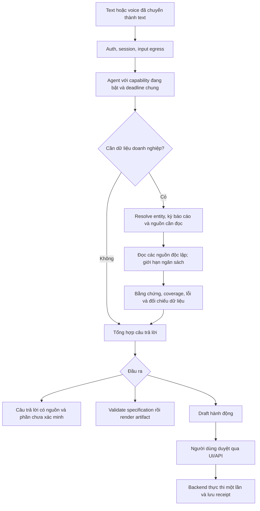

# Đánh giá và đề xuất tối ưu flow Enterprise Agent

Ngày khảo sát: 2026-10-20. Phạm vi: `enterprise-agent` trong working tree hiện tại.
Trạng thái: đã triển khai đợt độ tin cậy theo phạm vi người dùng duyệt ngày
2026-10-20, kiểm thử offline và xử lý các phát hiện từ review độc lập. Kế hoạch tại
`superpowers/plans/2026-10-20-agent-flow-reliability.md`.

## Quyết định đề xuất

Giữ **FastAPI + Microsoft Agent Framework + DeepSeek + các adapter IQ hiện có**.
Dùng một agent chính, kiểm soát thực thi bằng code và chỉ thêm các bước xử lý
phức tạp khi yêu cầu cần chúng. Ưu tiên sửa độ tin cậy của lượt chạy, rồi bổ sung
bằng chứng và đo hiệu năng trước khi quyết định thêm agent hoặc hệ thống index.

Mục tiêu được hiểu từ yêu cầu và master plan: trợ lý doanh nghiệp tổng quát có thể
đọc nhiều nguồn, tổng hợp, tạo tài liệu và soạn hành động để người dùng duyệt.
Tiêu chí ưu tiên được giả định là độ chính xác, độ trễ, chi phí và khả năng vận hành;
chưa có số đo live để xác định mức cải thiện phần trăm.

Các ràng buộc đã có: tự host backend, dùng DeepSeek trực tiếp, Agent Framework là
thư viện, Work IQ/Fabric theo quyền người đăng nhập, kiểm soát egress, sáu định dạng
artifact và approval qua backend. Không thay các quyết định này trong đợt tối ưu.

## Các repo tham khảo

Đã đọc README và các file được liên kết bên dưới qua GitHub/raw GitHub. Đây là
so sánh thiết kế; chưa clone, triển khai hay benchmark các repo này. Nhánh `main`
có thể thay đổi sau ngày khảo sát. Không có cơ sở kết luận repo nào nhanh nhất
trên dữ liệu và tenant của dự án này.

| Repo / nguồn trực tiếp | Điểm tương đồng đã kiểm tra | Áp dụng cho dự án |
| --- | --- | --- |
| [microsoft/iq-samples](https://github.com/microsoft/iq-samples) | Refund và travel agent kết hợp các IQ; đây cũng là repo gốc của workspace. | Giữ adapter và bài học tích hợp. Các sample dùng Foundry hosting nên không thay nguyên kiến trúc của mình bằng sample. |
| [microsoft/agent-framework — workflows](https://github.com/microsoft/agent-framework/blob/main/python/samples/03-workflows/README.md) | Có ví dụ phân nhánh, fan-out/fan-in, checkpoint và human-in-the-loop. | Dùng khả năng SDK sẵn có khi cần; không thêm framework điều phối thứ hai. API trên `main` phải đối chiếu bản đang pin trước khi dùng. |
| [onyx-dot-app/onyx](https://github.com/onyx-dot-app/onyx) | Trợ lý tri thức doanh nghiệp, connector, tìm kiếm, artifact và voice; bản có indexing cần thêm dịch vụ nền. | Học cách tách lớp context khỏi câu trả lời. Chỉ cân nhắc indexing khi đo được truy vấn lặp và lợi ích đủ bù chi phí đồng bộ/quyền truy cập. |
| [langchain-ai/open_deep_research — implementation](https://github.com/langchain-ai/open_deep_research/blob/main/src/open_deep_research/deep_researcher.py) | Tách research brief, nghiên cứu, nén kết quả và viết báo cáo; giới hạn vòng lặp và số nhánh nghiên cứu đồng thời. | Học cách giới hạn công việc và tách thu thập khỏi tổng hợp cho tác vụ dài. Không đưa toàn bộ supervisor/researcher loop vào mọi câu hỏi. |
| [langchain-ai/deepagents](https://github.com/langchain-ai/deepagents) | Harness cho công việc nhiều bước, quản lý context, filesystem, subagent và approval. | Học cách quản lý context theo nhu cầu. Thay SDK hiện tại bằng harness này sẽ cần kiểm chứng lại auth, egress, session và hành động. |
| [Azure-Samples/azure-search-openai-demo — retrieval flow](https://github.com/Azure-Samples/azure-search-openai-demo/blob/main/app/backend/approaches/chatreadretrieveread.py) | Tách nguồn dữ liệu/citation khỏi câu trả lời; cung cấp context trong response và streaming. | Đưa nguồn và coverage thành dữ liệu có cấu trúc, thay vì chỉ nhắc model phải trích dẫn trong prompt. Không cần chuyển model sang Azure OpenAI để học pattern này. |

Đánh giá mức phù hợp trong cột cuối là nhận định cho codebase này, không phải
kết quả benchmark hoặc cam kết của các repo tham khảo.

## Những gì flow hiện tại đã làm tốt

- JWT/OBO và session theo tenant/user; policy kiểm tra ở tool trước network call.
- Egress gate cho input và kết quả đọc từ các nguồn doanh nghiệp.
- Backend giữ quyền approve/execute; model chỉ có thể draft/request/status.
- Work IQ mutation chỉ thử một lần; runtime tránh replay khi đã ghi nhận tool call.
- Đã có schema artifact, renderer, lưu trữ bền vững và bộ kiểm thử offline.

## Các vấn đề ghi nhận ở baseline và thứ tự ưu tiên

### P0 — Artifact chưa được ghi vào tool-call recording

`src/enterprise_agent/artifacts/tools.py:create_artifact` gọi service nhưng không
gọi `record_tool_call`. `ArtifactService.create` phát audit riêng, không cập nhật
recorder của runtime. Trong khi đó, `agent/runtime.py:_with_retries` dựa trên
`get_recorded_tool_calls()` để quyết định có được retry toàn lượt hay không.

Đã tái hiện bằng runtime thật, `ArtifactTools` thật và service/model giả lập trong
bộ nhớ: tạo artifact xong thì model gặp `ConnectionError`; runtime retry và gọi
tạo artifact lần thứ hai. Kết quả: `artifact_creations=2`, `recorded_calls=[]`.
Probe không gọi provider và không tạo file thật.

Tác động: một lượt chỉ tạo artifact có thể bị replay; tool-selection eval có thể
không thấy `create_artifact`. Test multi-source hiện dùng artifact fake tự ghi
recorder, nên không phát hiện thiếu sót ở adapter thật.

Đề xuất: ghi nhận attempt tại adapter trước khi gọi service; xác minh cả chat và
stream không retry sau khi bắt đầu tạo artifact. Đây là ngăn replay trong runtime,
không phải bảo đảm exactly-once nếu client tự gửi lại một request mới.

### P0 — Timeout toàn lượt và timeout nguồn chưa nhất quán

Trong `config.py`, `deepseek_timeout_seconds=60`, `fabric_timeout_seconds=120`.
Runtime bọc toàn bộ `agent.run` trong timeout DeepSeek; factory còn dùng cùng giá
trị cho ngân sách tool loop. Vì vậy Fabric chưa dùng hết thời gian cho phép thì
lượt chạy đã có thể bị hủy. Mỗi retry toàn lượt hiện cũng có timeout riêng.

Đề xuất: phân biệt deadline toàn lượt, timeout một request model và timeout nguồn.
Chat và stream dùng chung chính sách. Thời gian chờ/backoff/retry phải trừ vào
deadline còn lại, với thời gian dành cho tổng hợp. Khi hết ngân sách, phản hồi phải
ghi rõ phần chưa hoàn tất. Không chỉ tăng đồng loạt mọi timeout.

### P1 — Workflow là chỉ dẫn trong prompt, chưa phải trạng thái có thể kiểm tra

`agent/workflows.py` chứa chuỗi hướng dẫn. `factory.py` gắn cùng
`SYSTEM_INSTRUCTIONS` cho mọi lượt, kể cả hướng dẫn về nguồn chưa bật.
Code chưa có hợp đồng chung mô tả đủ nguồn nào, thiếu nguồn nào và đã kiểm tra gì.

Đề xuất: giữ policy an toàn cố định; chỉ thêm hướng dẫn cho capability được bật.
Không loại tool dựa vào keyword tiếng Anh/Việt. Khi cần xử lý nhiều nguồn, lưu
trạng thái thu thập/đối chiếu/tổng hợp rõ ràng thay vì chỉ dựa vào văn bản hướng dẫn.

### P1 — Tool selection chưa chứng minh câu trả lời có căn cứ

`evals/evaluators/tool_selection.py` kiểm tra tập tên tool expected/forbidden.
Nó không kiểm tra thứ tự, thành công, đọc đủ nội dung, đối chiếu kỳ báo cáo hoặc
artifact có thực sự tồn tại. `ArtifactSpec.sources` hiện là danh sách tùy chọn
do caller cung cấp; `ChatResponse` chưa có trường nguồn/coverage riêng.

Đề xuất: thêm metadata kết quả tool và sổ bằng chứng theo lượt, rồi kiểm tra nguồn
được trích dẫn có tồn tại và được phép dùng. Kiểm tra tự động này chỉ xác minh
provenance/coverage; chất lượng suy luận vẫn cần eval riêng trên dữ liệu kiểm soát.

### P1 — Đọc từng chunk Work IQ tải và extract lại toàn file

`tools/workiq/tools.py:workiq_read_document` luôn gọi `fetch_blob`, decode và
extract toàn bộ file trước khi cắt đoạn 3.500 ký tự theo offset.

Đề xuất: tái sử dụng kết quả extraction trong cùng một lượt, với key gồm chủ thể
đã xác thực, đường dẫn và phiên bản nếu nguồn có cung cấp. Giới hạn bộ nhớ; xóa khi
lượt kết thúc; egress vẫn áp dụng cho từng chunk trả về. Không cache lỗi và không
dùng cache nội dung giữa người dùng hoặc giữa các lượt trong giai đoạn này.

### P2 — Cần đo trước khi thêm parallelism hoặc pooling

Đã kiểm tra SDK cài trong `.venv`: `agent_framework/_tools.py` thực thi các tool
cùng batch bằng `asyncio.gather`. `workiq_fetch` cũng nhận nhiều resource paths.
Không thể kết luận toàn bộ flow hiện đang chạy tuần tự.

Các MCP adapter tạo HTTP client/session và initialize cho mỗi lần gọi. Đây là
ứng viên tối ưu cần đo, chưa đủ cơ sở để thêm pool theo user/token ngay lập tức.
Ưu tiên số lần gọi, stage duration, byte/context size, cache hit, token và thời gian
đến nội dung đầu tiên. Chỉ song song các read độc lập; resolve entity trước các
truy vấn phụ thuộc; không chạy render song song với thu thập dữ liệu còn thiếu.

## So sánh ba hướng

| Hướng | Lợi ích | Đánh đổi | Quyết định |
| --- | --- | --- | --- |
| Chỉ sửa prompt | Thay đổi ít, triển khai nhanh. | Không xử lý replay artifact hoặc deadline; provenance vẫn khó kiểm tra. | Chỉ là một phần nhỏ của đợt tối ưu. |
| Một agent + kiểm soát thực thi và bằng chứng | Tái sử dụng stack, sửa đúng các khoảng trống đã thấy, có thể đo từng bước. | Cần hợp đồng trạng thái và eval kết quả bổ sung. | **Chọn hướng này.** |
| Chuyển sang nền tảng indexed search hoặc harness đa agent | Có sẵn nhiều thành phần cho tìm kiếm lớn/tác vụ dài. | Thêm chi phí vận hành hoặc migration; cần kiểm chứng lại tích hợp và quyền. | Xem xét sau khi có số đo và nhu cầu thực tế. |

## Flow đề xuất

Đây là flow logic, không mặc định mỗi ô là một lần gọi model. Câu hỏi đơn giản
tiếp tục dùng agent loop hiện có. Lập kế hoạch/kiểm chứng bằng model bổ sung chỉ
được đưa vào khi eval cho thấy cần thiết, có giới hạn rõ ràng.

Với tác vụ nhiều nguồn, bổ sung cấu trúc dữ liệu theo lượt:

- Nguồn: ID do backend cấp, loại nguồn, reference an toàn, thời điểm và trạng thái.
- Coverage: file/chunk đã đọc, phần còn lại, nguồn lỗi, trích xuất rỗng hoặc bị chặn.
- Đối chiếu: entity, kỳ báo cáo, đơn vị, tiền tệ; mâu thuẫn chưa giải quyết.
- Kết quả: hoàn tất, một phần hoặc bị chặn; reference và receipt có thể kiểm tra.

Một nguồn lỗi không trở thành dữ liệu rỗng được coi là hợp lệ. Câu trả lời một
phần phải nêu giới hạn. Dữ kiện doanh nghiệp phải có nguồn; suy luận và giả định
được ghi nhãn. Nội dung soạn thảo chung không cần bị buộc có nguồn doanh nghiệp.
Không truyền thông tin token hay dữ liệu bị egress chặn vào cấu trúc này.

## Phạm vi triển khai được đề nghị

**Đợt đầu — độ tin cậy của lượt chạy:** bổ sung recording artifact và kiểm thử
adapter thật qua runtime; tách deadline/timeout; tạo prompt theo capability;
thêm timing và eval phát hiện replay hoặc tool thành công giả. Giữ API/SSE hiện
có và hai chế độ demo/deepseek. Không thêm dependency hay dịch vụ mới.

**Đợt sau — bằng chứng và context:** chuẩn hóa kết quả read, cache extraction trong
lượt, nguồn/coverage và kiểm tra artifact. Nếu thêm trường API hoặc SSE event thì
phải có mặc định tương thích và cập nhật UI. Không coi lưu session hội thoại là
checkpoint của một workflow đang chạy; resume bền vững là phạm vi riêng.

**Sau số đo live:** mới quyết định thêm index, pool kết nối hoặc workflow cho tác vụ
dài. Các thay đổi này cần thiết kế riêng, không gộp vào việc sửa P0.

## Cách đánh giá hiệu quả

1. Tái hiện lỗi sau artifact creation: service chỉ được gọi một lần dù model lỗi;
   call xuất hiện trong response/eval; kiểm tra cả chat và stream.
2. Model chậm, Fabric chậm, retry/backoff và stream phải cùng tuân thủ deadline;
   timeout không khiến write hoặc artifact bị replay.
3. Prompt chỉ chứa hướng dẫn capability đang bật nhưng giữ đầy đủ policy an toàn.
4. Tác vụ báo cáo phải đọc nội dung trước khi render; file trích dẫn chưa đọc,
   coverage thiếu và entity/kỳ báo cáo mâu thuẫn phải được phát hiện.
5. Đọc nhiều chunk một file: extraction được tái sử dụng trong lượt và không rò
   giữa hai chủ thể; không phục hồi nội dung đã bị egress chặn.
6. Đo trước/sau trên cùng tập truy vấn, model, cấu hình và tenant: độ đúng, nguồn,
   call count, token, p50/p95 latency và thời gian phản hồi đầu tiên. Không đổi
   chất lượng lấy tốc độ; chỉ công bố chi phí tiền khi có biểu giá đã xác minh.

## Baseline đã chạy

- `.venv/Scripts/python.exe -m pytest -m "not live" -q`: **197 passed, 2 skipped,
  7 deselected**. Hai skip là renderer Node tùy chọn chưa có; một cảnh báo
  deprecation từ Starlette/AnyIO.
- `.venv/Scripts/python.exe -m ruff check enterprise-agent` từ root: **pass**.
- Lần chạy pytest đầu bị Windows sandbox chặn thư mục tạm; lần chạy lại được
  cấp quyền hoàn tất. Không coi lỗi fixture môi trường ban đầu là lỗi sản phẩm.
- Probe artifact replay nêu trên chạy trong bộ nhớ và tái hiện hai lần tạo.
- Không chạy eval/provider live; chưa đo latency/chi phí thực, quyền tenant hoặc
  khả năng tương thích DeepSeek live. Test offline pass không chứng minh các mục đó.

## Phạm vi đã được duyệt

Người dùng đã duyệt hướng **một agent + kiểm soát thực thi và bằng chứng**, bắt
đầu với đợt độ tin cậy. Đợt bằng chứng/context và các thay đổi hạ tầng chưa thuộc
phạm vi triển khai đầu tiên. Các thay đổi chưa commit có sẵn trong working tree
được giữ nguyên, không đưa vào commit hoặc refactor ngoài phạm vi.

## Kết quả triển khai đợt đầu

- Artifact ghi nhận attempt trước khi render. Kiểm thử với service/file thật cho
  cả chat và stream xác nhận model lỗi sau tạo file không làm replay toàn lượt;
  hết tool budget thì không ghi thêm file.
- Tách timeout HTTP của DeepSeek khỏi deadline toàn lượt; SDK không tự retry HTTP.
  Deadline chung bao gồm chờ session, backoff, thực thi và lưu session. Các nguồn
  chia sẻ cutoff đọc để dành thời gian tổng hợp; không thay policy egress/approval.
- Prompt chỉ ghép hướng dẫn cho capability bật, giữ policy an toàn cho mọi cấu hình.
  Không thêm model call để phân loại hoặc routing theo keyword.
- Audit ghi thời gian lượt chạy, thời gian đến text đầu tiên, số attempt và thời
  gian đọc nguồn; không đổi schema API/SSE hay ghi nội dung vào các event này.
- Đã sửa các trường hợp review tái hiện: lưu session bị hủy làm lệch phiên bản;
  circuit breaker kẹt ở recovery probe; xóa session khi save nền còn chạy hoặc đã
  lỗi. Lượt chờ sau thao tác xóa dùng session mới, không lấy lại lịch sử cũ.

Xác minh cuối: **253 passed, 2 skipped, 7 deselected** cho toàn bộ test offline;
Ruff và `git diff --check` pass. Hai skip thuộc renderer Node tùy chọn; một cảnh
báo deprecation từ Starlette/AnyIO. Reviewer xác nhận không còn phát hiện blocking.

Chưa chạy provider/tenant live, chưa đo latency/chi phí thực. Các worker đồng bộ
đã bắt đầu không thể bị cưỡng bức dừng bằng asyncio cancellation; commit session
đang chạy được theo dõi và điều phối để lượt tiếp theo/xóa session không đua với nó.
Thiết lập vận hành và giới hạn được ghi trong `OPERATIONS.md`.
